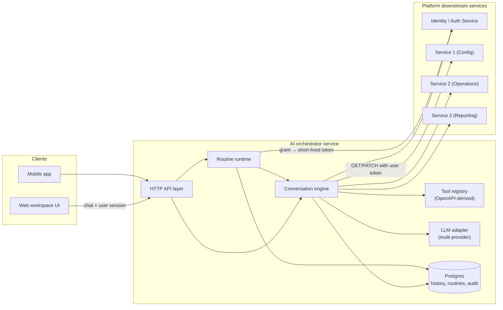
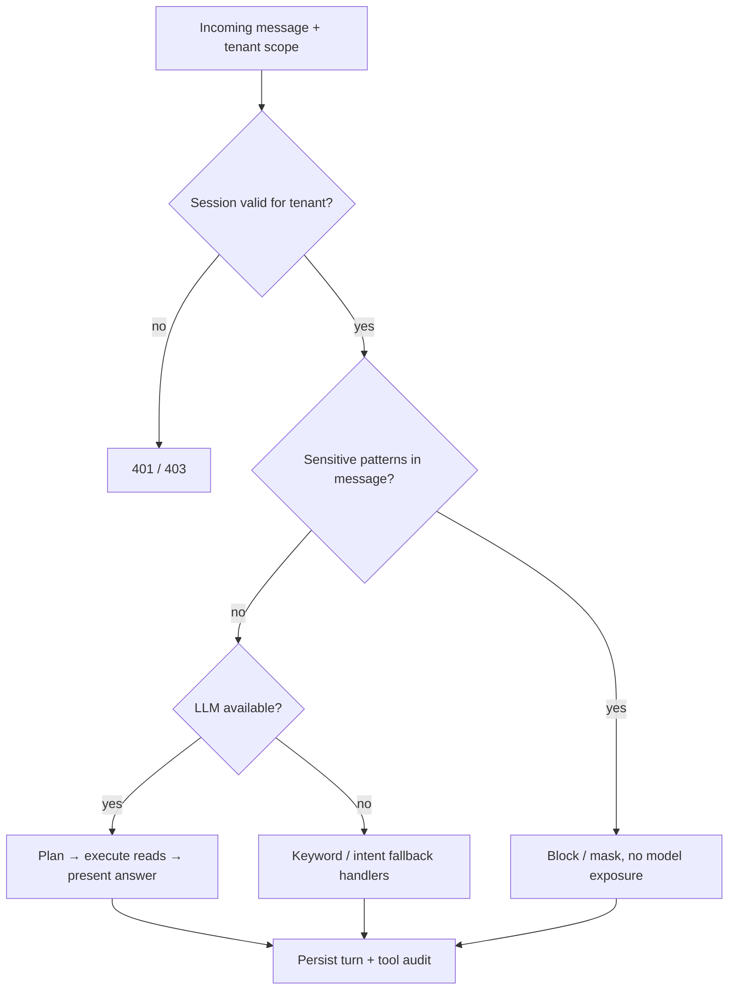
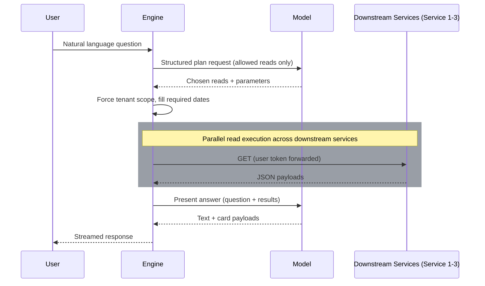
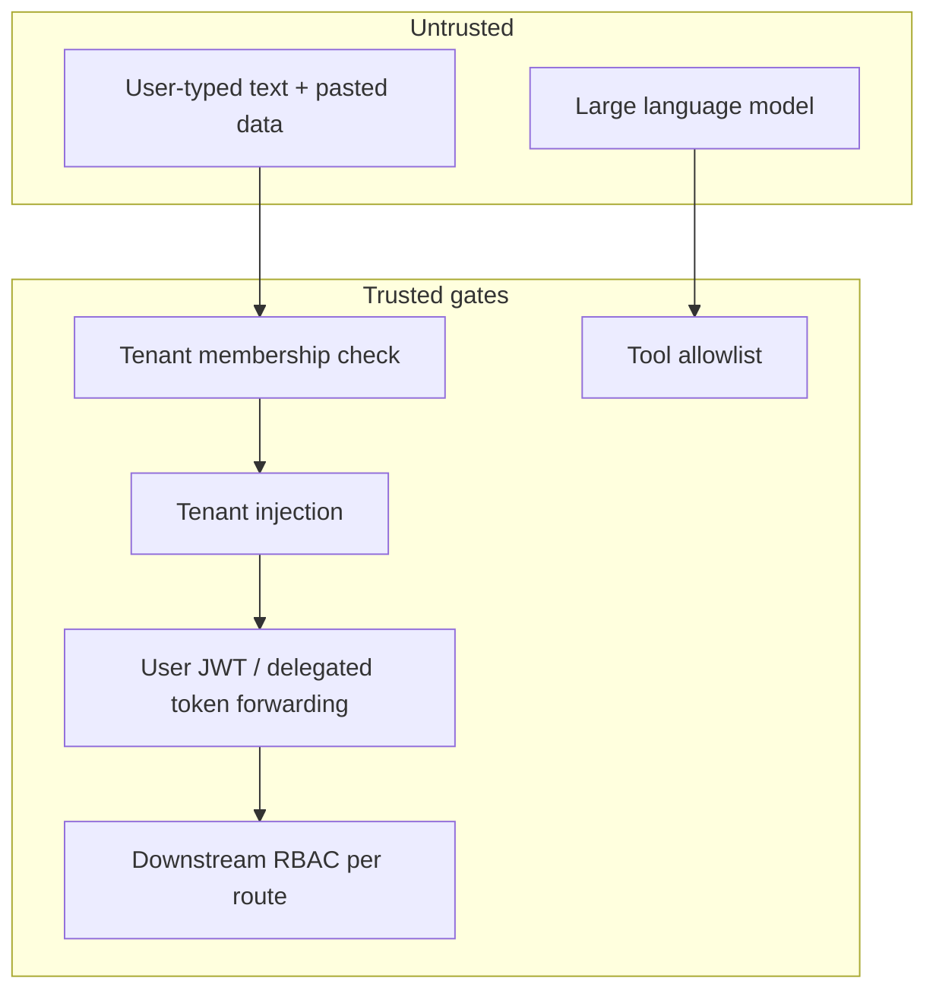
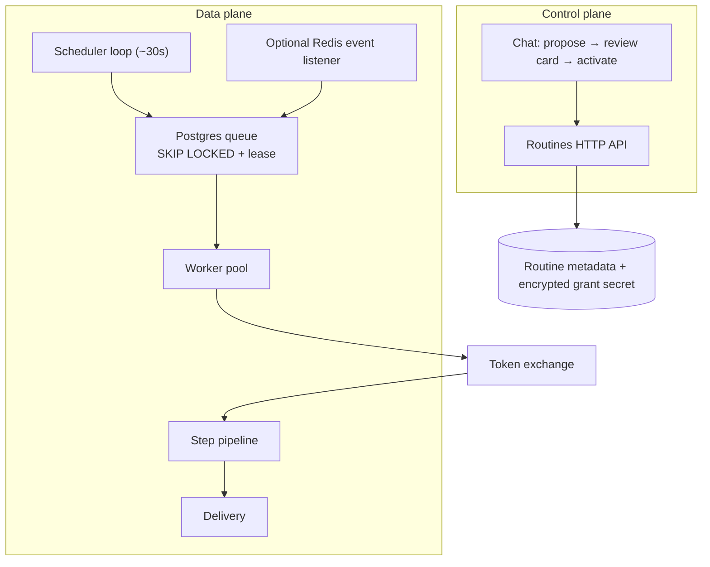
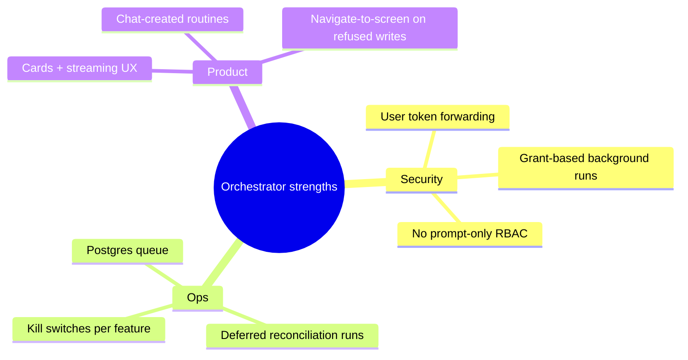

## TL;DR

The enterprise AI orchestrator is not “an LLM glued to a database.” It is an **orchestration layer** between business users (or external AI clients), **multiple backend microservices**, and **one tenant/organization scope at a time**. The service plans which read APIs to call, runs them with the **caller's credentials**, turns JSON into structured UI cards, and—on a separate track—executes **saved routines** in the background using **revocable delegated grants**. Security lives in **server-side gates**, not in prompt instructions.

> [!TIP]
> **Blueprint & Template Notice:** This architecture was generalized from real-world production engineering into a reusable, zero-trust system pattern. Reusable starter templates and code scaffolding for Go + LLM tool orchestration will be open-sourced soon!

---

## The problem we were solving

A modern multi-service enterprise platform is not one monolithic API. Core capabilities—such as Service 1 (Platform Config & Settings), Service 2 (Core Business Operations), Service 3 (Analytics & Reporting), and the Identity / Auth layer—each live in separate microservices with their own OpenAPI surfaces, RBAC rules, and operational semantics (business dates, fiscal time zones, compliance constraints).

Team questions sound simple—“Which accounts renewed this week?” or “What was gross volume yesterday?”—but answering them reliably means:

1. Picking the right endpoints and query parameters from hundreds of possibilities.
2. Never widening scope beyond **one tenant/organization**.
3. Never exceeding what the **signed-in user** is allowed to see.
4. Presenting numbers in a UI-friendly shape (tables, charts, stats)—without letting the model invent figures.

Later, product asked for **automation**: daily briefing digests, metric-threshold alerts, and scheduled workflows that run **while nobody is logged in**—still as the user who created them, still auditable, still revocable.

That combination pushed us toward a **dedicated orchestration service** rather than bolting chat into any single backend.

---

## High-level system view



**Design principle:** The orchestrator does not own the business data. It **coordinates** reads and guarded writes against services that already enforce authorization.

---

## Two conversation modes, one security model

### Interactive chat

The primary path is streaming chat:



**Planner path (happy path):**



**Fallback path** when the model is down, misconfigured, or the question maps to a hand-tuned handler: a classifier routes to dedicated code paths (daily summaries, balance queries, metric readiness, etc.).

### Agent goals and guarded writes (evolution)

The orchestrator began as **read-first** for trust and compliance. Product then needed multi-step operational workflows (entity assignment, status updates, bulk actions) and API-shaped creates/updates.

The architecture adds an **agent loop** that:

- Reads until it has enough context.
- Starts **in-chat flows** that still require human confirmation for sensitive changes, **or**
- Prepares writes from OpenAPI schemas with **dynamic form cards**, with an explicit save path that marks the request as user-approved.

For **unattended** execution (routines), a separate flag enables autonomous writes under a **routine-specific write allowlist**, with every mutation going through the same audit channel as interactive chat.

This split—**interactive confirmation vs autonomous routine**—is intentional: humans keep the loop for ad-hoc chat; automation gets a narrow, reviewed allowlist.

---

## Tool registry: APIs as typed tools

Instead of hard-coding every integration, the orchestrator **generates a catalog** from sibling services’ Swagger/OpenAPI definitions:

| Stage    | What happens                                                                              |
| -------- | ----------------------------------------------------------------------------------------- |
| Codegen  | Read specs → generate HTTP client stubs                                                   |
| Filter   | Drop admin, internal, export, impersonation, and non-GET tools from the default read pool |
| Metadata | Attach query param hints, RBAC notes, display labels                                      |
| Runtime  | Model sees **names and descriptions**, not raw OpenAPI                                    |

Illustrative filter logic (pseudocode—**not production code**):

```go
func IsPermittedReadTool(tool ToolMeta) bool {
    if tool.Method != "GET" { return false }
    if containsAny(tool.Path, []string{"/internal/", "export", "impersonat"}) {
        return false
    }
    return true
}
```

At request time, the engine **overwrites** `tenantId` (and path-style tenant parameters) so even a malicious or confused model cannot pivot across tenants.

---

## Layered security (what we trust—and what we do not)



| Control        | Chat                                          | Routines (background)                            |
| -------------- | --------------------------------------------- | ------------------------------------------------ |
| Identity       | User session JWT                              | Revocable **grant** + token exchange             |
| Tenant scope   | Required on every request                     | Stored on grant; re-checked at exchange          |
| Permissions    | Downstream returns 403 → denied card          | Same; persistent auth errors **suspend** routine |
| Compliance/PCI | Sensitive patterns masked before logs/DB/model| Same validation on saved definitions             |
| Audit          | Per-tool execution rows + audit log on writes | Same pipelines; `source=routine` on turns        |

**Key insight for leaders:** The orchestrator does not maintain its own permission matrix. If the downstream backend says “no,” the orchestrator says “no.” That avoids a whole class of “AI bypassed RBAC” incidents—at the cost of **opaque error messages** when roles are misconfigured upstream.

---

## Routines: scheduled and event-driven automation

Routines are **JSON definitions** validated by the server (not the model). A routine describes:

- **When** it runs (schedule, one-shot, or condition with hysteresis).
- **What** steps execute (reads, transforms, capability actions, agent prompts, notifications).
- **Where** results go (in-app inbox, chat thread, email).



### Package layering (why it matters)

To avoid import cycles between “pure routine logic” and the heavy conversation engine:

| Layer               | Responsibility                                                         |
| ------------------- | ---------------------------------------------------------------------- |
| Pure routine domain | Schema, validation, scheduling math, pipeline DSL                      |
| Credentials         | Seal grant secrets, cache short-lived tokens                           |
| Service             | CRUD, scheduler, workers, delivery                                     |
| Engine adapter      | Implements runtime interface: reads, writes, capabilities, agent steps |

**Queue choice:** Postgres `FOR UPDATE SKIP LOCKED` instead of introducing Temporal/EventBridge on day one—same database the orchestrator already requires, survives restarts, scales horizontally with multiple replicas.

### Condition triggers and edge detection

Occupancy-style alerts use **edge triggering** with **hysteresis** so flapping at a threshold (80% → 81% → 80%) does not spam staff. Optional Redis pub/sub accelerates reaction to domain events (e.g. from Service 2); a **reconciliation tick** still runs when messages are missed.

---

## Observability and the staff experience

**Streaming protocol:** Clients receive `thinking`, per-read `tool_start` / `tool_end`, then text and cards. The **work log** in message metadata is the source of truth for “what the agent did” when replaying history—important when support debugs “it said X but the numbers look wrong.”

**Business date, not clock date:** “Today” means the business operating date (e.g. daily ledger cycle or operational business date), cached briefly from configuration—otherwise morning-shift questions drift from operational reality.

**Cards, not blobs:** Answers are constrained (row/column/chart point limits) so the UI stays fast and the model cannot dump megabytes of JSON into the panel.

---

## Merits of this architecture

| Merit                                          | Why it pays off                                                                                                    |
| ---------------------------------------------- | ------------------------------------------------------------------------------------------------------------------ |
| **RBAC parity with the web app**               | No shadow permission system; security reviews stay centralized in identity + route middleware.                     |
| **OpenAPI-driven expansion**                   | New microservice endpoints can surface as tools after registry regen + filter review—not bespoke glue per feature. |
| **Defense in depth without prompt reliance**   | Tenant forcing, tool allowlists, compliance guards, and audit logs survive model changes or provider swaps.         |
| **Graceful degradation**                       | `LLM_PROVIDER=none` still yields keyword/intent answers—useful in outages or strict environments.                  |
| **Unified automation story**                   | Routines reuse the same engine, write path, and audit as chat—reduces “batch job bypassed controls” risk.          |
| **Multi-provider LLM**                         | Adapter layer supports switching vendors without rewriting orchestration.                                          |
| **Horizontal routine workers**                 | Lease-based claiming lets you scale replicas without double-running the same slot (idempotent `run_key`).          |
| **Explicit human gate for interactive writes** | Preserves trust for team members who need confidence before mutations occur.                                       |



---

## Demerits, tradeoffs, and sharp edges

| Demerit                                       | Impact                                                               | Mitigation direction                                                               |
| --------------------------------------------- | -------------------------------------------------------------------- | ---------------------------------------------------------------------------------- |
| **Large flat engine package**                 | Hard to navigate, risky refactors, cycle constraints when splitting  | Incremental extraction (tool-call helpers, policy package) per dependency analysis |
| **Dual paths (planner vs fallback vs agent)** | Behavior drift if handlers and planner disagree                      | Shared read helpers; tests on golden questions                                     |
| **LLM cost + latency**                        | Every planned turn may need 2+ model calls                           | Caps on follow-up rounds; routine “recipe” steps that skip the model               |
| **Registry churn**                            | A bad OpenAPI publish can expose or break tools                      | CI registry gen + allowlist review                                                 |
| **Tenant switch state (some MCP paths)**      | In-memory active tenant per pod resets on restart / load balancing   | Document UX; eventual shared session store                                         |
| **Grant + exchange dependency**               | Routines fail closed when identity service is down                   | Suspend + notify; retries with backoff                                             |
| **Event payloads are thin**                   | Redis events signal invalidation, not entity data → extra reads      | Debounce + reconciliation tick                                                     |
| **Passthrough JSON to models**                | Prompt injection via freeform text fields in Service 2 payloads      | Treat all tool arguments as hostile; never widen scope                             |
| **Operational complexity**                    | Two HTTP servers, optional Redis, many feature flags                 | Runbooks, env documentation, staged rollout flags                                  |
| **Testing burden**                            | Matrix of intents × RBAC × providers × routine steps                 | Mock downstream HTTP in tests; acceptance docs per phase                           |

**Honest architectural tension:** The more capable the orchestrator becomes (writes, autonomous routines, external tool servers), the **less** you can rely on “read-only assistant” mental models from early documentation. Operators must treat the agent as **automation infrastructure**, not a fancy search box.

---

## Configuration surface (illustrative)

Environment toggles let you roll out safely—names are representative; values belong only in secure config stores:

```bash
# Core
PORT=8090
LLM_PROVIDER=openai   # or anthropic, gemini, none

# Automation
ROUTINES_ENABLED=true
ROUTINE_WRITES_ENABLED=true
ROUTINE_EVENTS_ENABLED=false

# Optional acceleration for condition routines
REDIS_URL=...
```

Feature flags are a **merit** for incremental delivery and a **demerit** when drift between staging and production hides integration bugs—discipline on defaults matters.

---

## What we would do again—and what we might change

**Would do again:**

- Server-side tenant injection before any downstream call.
- Separate **validation authority** for routine JSON vs model prose.
- Postgres-backed work queue before adopting workflow engines.
- Keeping identity as the only source of “who is this token.”

**Might change with hindsight:**

- Earlier extraction of a small `toolcall` package shared by chat and external protocol servers (covered in the **next** post).
- Stronger contract tests between generated registry and live microservice deployments.
- Clearer product docs when writes and routines shipped—so support and compliance teams share one story.

---

## Roadmap teaser: external AI clients

The same binary exposes a **second HTTP listener** designed for Model Context Protocol (MCP) clients: no in-house planner, OAuth at the edge, short-lived delegated tokens, and the **same read tool filter** as chat. That design gets its own deep dive in the companion article: _“[Building a Read-Only MCP Tool Server: Zero-Trust Enterprise Data Access for Claude, Cursor, and Beyond](/blog/hotel-pms-mcp-tool-server).”_

---

## Glossary (reader-friendly)

| Term              | Meaning                                                                        |
| ----------------- | ------------------------------------------------------------------------------ |
| **Orchestrator**  | Service that plans, calls APIs, and formats responses—not the system of record |
| **Business date** | Operational “today” per ledger reconciliation cycle                            |
| **Card**          | Typed UI payload (table, chart, stat, form, confirm, navigate)                 |
| **Routine**       | Saved, validated automation definition with triggers and delivery              |
| **Grant**         | User-consented credential allowing background token exchange                   |
| **Tool**          | Named, schema-bound call into a downstream HTTP API                            |

---

## Summary

The system architecture is a **policy-enforced orchestration layer** on top of a multi-service enterprise platform: multi-path conversation handling, OpenAPI-derived tools, Postgres-backed automation, and a security model that **delegates authority** instead of **elevating** the AI. The merits are RBAC fidelity, extensibility, and a unified audit story; the demerits are complexity, coupling to OpenAPI quality, and the ongoing cost of keeping **three execution modes** (planner, handlers, agent/routines) aligned.
