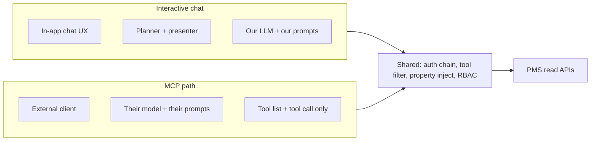
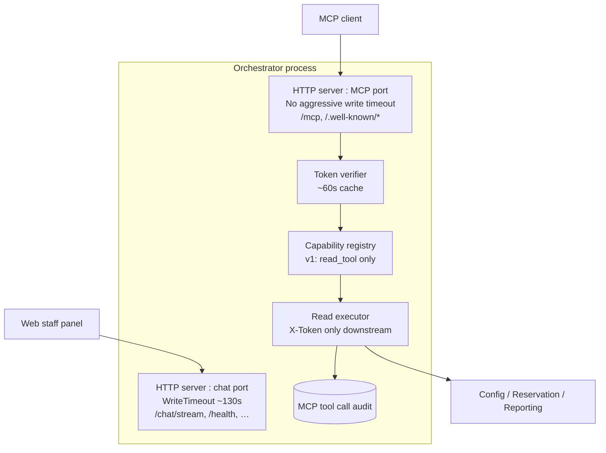
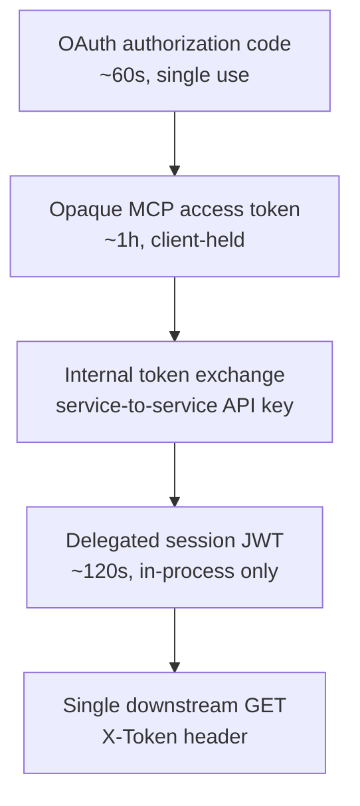
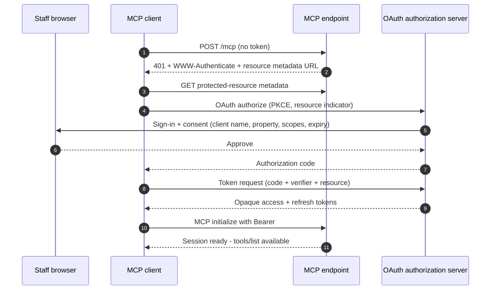
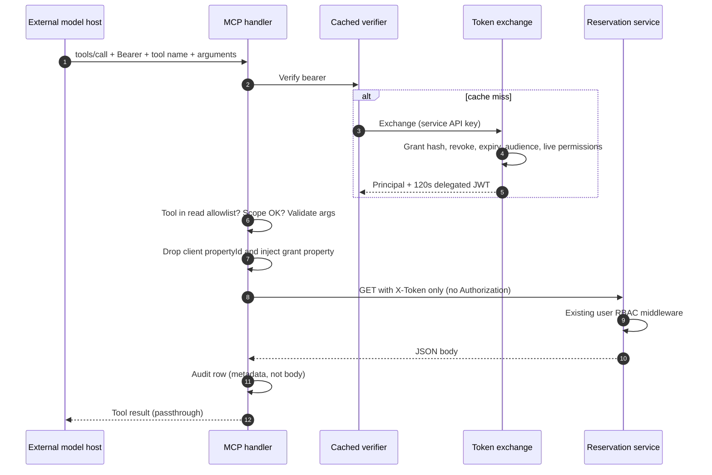
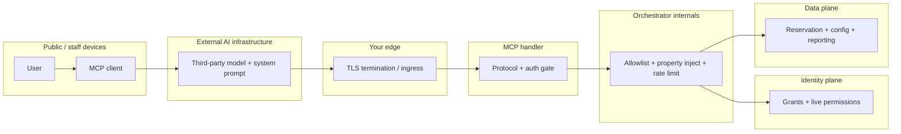
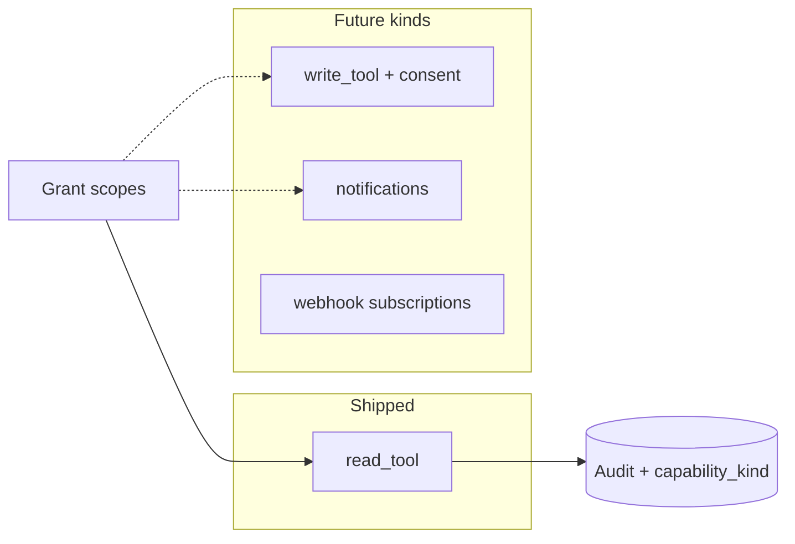
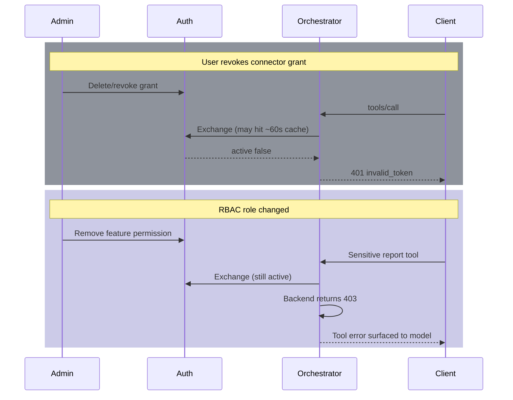
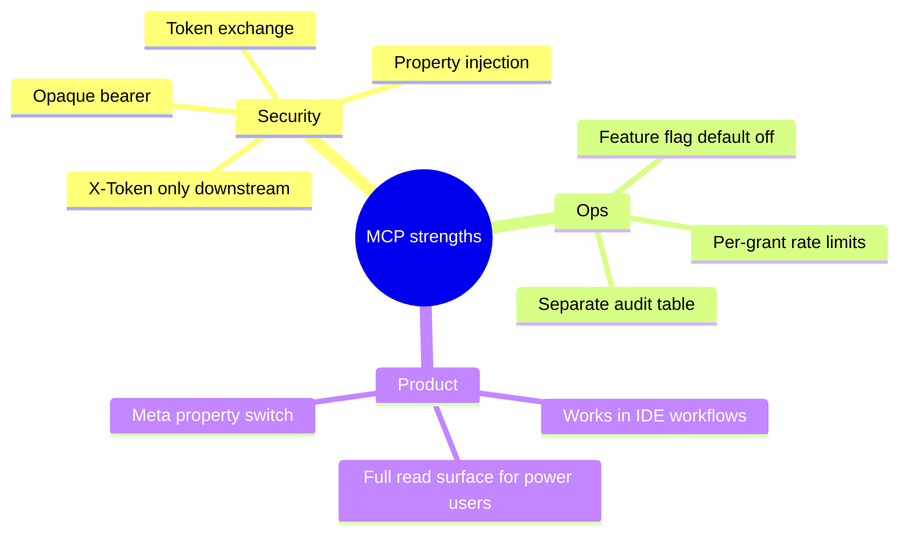
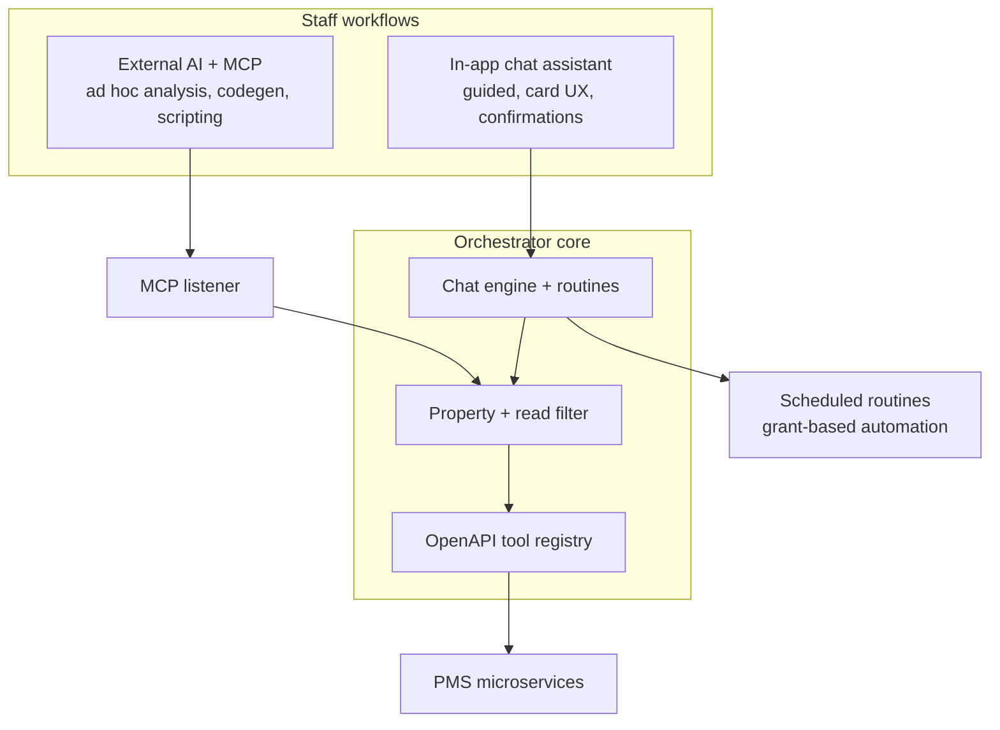

_Companion to: [Inside a Hotel PMS AI Orchestrator: Multi-Service LLMs, Automation, and Zero-Trust Access](/blog/hotel-pms-ai-orchestrator)_

## TL;DR

The in-product chat path owns the **model, prompts, and UX**. The **Model Context Protocol (MCP)** path is deliberately different: the orchestrator becomes a **tool server**—no planner, no `present_answer`, no chip UX. External clients (e.g. Claude on the web, Claude Code, Cursor remote MCP) bring their own system prompts and reasoning. Security cannot live in instructions; it must live in **OAuth consent, token exchange, tool allowlists, mandatory property injection, downstream RBAC, rate limits, and audit**. v1 is **read-only**, parity-filtered with interactive chat, with JSON **passthrough** like the chat executor.

---

## Why a second interface?

Staff already ask questions inside the PMS via the in-app chat agent. Product also wanted **the same hotel data** available where power users already work: AI-native IDEs and assistants that speak MCP.

That sounds like “expose our APIs to Claude.” In a multi-service PMS with heterogeneous auth header semantics and no audience on legacy session JWTs, the naive approach fails quickly:

| Naive approach                                       | What breaks                                                                   |
| ---------------------------------------------------- | ----------------------------------------------------------------------------- |
| Forward the user’s browser JWT to MCP                | Long-lived credential leaves the browser trust zone; external client holds it |
| Forward MCP bearer to reservation/config APIs        | Downstream services interpret `Authorization` differently (M2M vs user)       |
| Let the model pass `propertyId`                      | Cross-property data exfiltration via tool arguments                           |
| Rely on “don’t call admin APIs” in the system prompt | **Prompt controls do not apply** on MCP—there is no in-house planner             |

The MCP design accepts a hard split:



**Merit:** One orchestrator binary, one tool registry filter, one RBAC story.  
**Demerit:** Operators must understand **two security postures**—chat has prompt-side guardrails; MCP does not.

---

## Physical layout: one process, two HTTP servers

Chat and MCP share Postgres, the generated tool registry, and auth integration—but **not** the same `http.Server` tuning:



Illustrative startup gating (pseudocode):

```go
if envBool("MCP_ENABLED") {
    go mcpServer.ListenAndServe() // separate from chat server
}
// MCP_ENABLED=false → port not bound (feature absent, not 403)
```

**Why two servers?** Chat streaming fits a bounded write timeout. MCP sessions (Streamable HTTP) can outlive that window; killing the connection mid-session is worse than isolating listeners.

---

## Credential ladder: four layers, two rules

MCP introduces a **credential ladder** so each hop only means what it should:



| Credential       | Holder              | Lifetime         | Appears on                             |
| ---------------- | ------------------- | ---------------- | -------------------------------------- |
| OAuth code       | Client ↔ Auth       | Seconds          | Token endpoint only                    |
| MCP access token | External AI client  | ~1 hour          | `Authorization: Bearer` on `/mcp` only |
| Service API key  | Orchestrator ↔ Auth | Rotation-managed | Internal exchange only                 |
| Delegated JWT    | Orchestrator memory | ~120 seconds     | `X-Token` on **one** PMS call          |

**R1 — Opaque bearer:** The MCP access token is meaningless to PMS APIs. Only the identity service’s grant table can interpret it.

**R2 — Delegated JWT never egresses:** Minted for one downstream call, dropped immediately—never returned to Anthropic, never logged, not cached like introspection.

Illustrative exchange contract (shape only):

```json
{
  "grant_type": "urn:ietf:params:oauth:grant-type:token-exchange",
  "subject_token": "<opaque>",
  "audience": "https://<canonical-mcp-resource-uri>",
  "requested_token_type": "urn:ietf:params:oauth:token-type:jwt"
}
```

**Deliberate absence:** No `user_id`, `property_id`, or `act_as` fields on the exchange request—the endpoint cannot become an impersonation oracle.

On success, the identity service returns `active`, scopes, **`property_id` from the grant**, and a short-lived `delegated_token`. On failure, **`{ "active": false }`** without distinguishing _why_—mitigating token enumeration.

---

## OAuth and consent: property on the consent screen



Product-locked v1 behavior:

| Requirement         | Behavior                                                                                                  |
| ------------------- | --------------------------------------------------------------------------------------------------------- |
| Read-only           | No write tools; same GET filter as chat planner pool (~hundreds of tools, not exact count in public docs) |
| Coarse OAuth scope  | e.g. `pms:read` gates _whether_ MCP attempts reads; **RBAC on each route** still decides success          |
| One active property | Default `propertyId` on grant; answers are for **one hotel context** like chat                            |
| Property switch     | Meta-tool to change active property after live permission re-check                                        |
| Data egress         | **Passthrough JSON** like chat `execTool`—no MCP-only field stripping                                     |

RFC 8707-style **resource** binding ties tokens to the canonical MCP URI so audience confusion across environments is harder.

---

## One tool call, end to end



Pseudocode for the critical control:

```go
func executeReadTool(principal Principal, tool string, args map[string]any) {
    if !readAllowlist.Contains(tool) {
        return denied("tool_not_exposed")
    }
    args = stripAndInjectProperty(args, principal.PropertyID)
    jwt := principal.DelegatedToken // 120s, single use
    resp := httpGet(tool, jwt, args) // header: X-Token only
    audit(tool, principal, latency, outcome)
    return passthrough(resp)
}
```

**Confused-deputy guard:** Downstream calls use **`X-Token` only**. Setting `Authorization` on PMS clients would conflate M2M keys with user sessions across services.

---

## Trust boundaries and prompt injection



| Boundary             | What crosses                       | Control                                        |
| -------------------- | ---------------------------------- | ---------------------------------------------- |
| User → AI cloud      | OAuth grant intent                 | Consent UI names property + client             |
| AI → your edge       | Opaque bearer, tool args           | TLS, optional egress IP allowlist, rate limits |
| Handler → internals  | Resolved user, client id, property | Introspection + audience check                 |
| Internals → identity | Subject token only                 | Service API key, no user impersonation params  |
| Internals → data     | Short-lived user JWT               | RBAC per route, 20s read timeout (v1)          |
| Data → AI            | Full JSON (passthrough)            | Same egress as chat-to-LLM—**including PII**   |

**The uncomfortable truth (demerit):** The model may read reservation remarks, guest notes, or any field RBAC allows. An attacker who can influence text the model later reads (e.g. malicious booking comments) can attempt **indirect prompt injection**. MCP mitigation is **not** “tell Claude to ignore remarks”—it is **treat every tool argument as hostile**, never trust client-supplied property scope, and monitor audit for anomalous tools.

---

## Shared vs separated: architectural comparison

| Concern                       | Chat `/chat/stream`        | MCP `/mcp`                 | Shared?                               |
| ----------------------------- | -------------------------- | -------------------------- | ------------------------------------- |
| Process binary                | Yes                        | Yes                        | **Shared**                            |
| HTTP server instance          | Chat listener              | MCP listener               | **Separated**                         |
| Caller authentication         | User session JWT           | OAuth opaque bearer        | **Separated**                         |
| Permission authority          | Auth service               | Same lookups via exchange  | **Shared**                            |
| Tool surface                  | Planner picks subset       | Full allowed read registry | **Shared filter, different exposure** |
| Model                         | In-app configured LLM       | Client’s model             | **Separated**                         |
| Prompt policy                 | Planner, refuse rules, PCI | **None**                   | **Separated**                         |
| Downstream credential         | User JWT (~hours)          | Delegated JWT (~minutes)   | **Separated**                         |
| Turn audit                    | Chat tool executions       | Dedicated MCP audit table  | **Separated schema**                  |
| LLM calls inside orchestrator | Yes                        | **No**                     | MCP is not an LLM proxy               |

**Merit for security reviews:** Anything that only existed in prompts **does not protect MCP**. The checklist shrinks to server-enforced controls.

**Demerit for product:** Behavior diverges—chat might refuse a phrasing that MCP still retrieves if RBAC allows the underlying GET.

---

## Tool surface and capability registry

v1 registers one **capability kind**: `read_tool`.



| Filter layer   | What it removes (examples)                             |
| -------------- | ------------------------------------------------------ |
| Method         | Non-GET operations                                     |
| Path fragments | Admin, internal routes, export, impersonation, invites |
| Property scope | Org-wide listings outside active property              |
| Product v1     | All writes                                             |

Chat **narrows** which reads the planner mentions; MCP **lists** the full filtered set so the client model can call any read the user’s role already allows—aligned with “show me everything I’m permitted to see.”

**Meta-tools (v1):**

- Set active property (re-validates permissions).
- Get session context (active property, user attribution for client UX).

Input schemas on read tools are intentionally **permissive** (`additionalProperties`) so nested query objects (e.g. report PDF parameters) match chat’s parameter preparation—at the cost of weaker JSON Schema validation at the MCP edge.

---

## Revocation and permission drift



| Event                      | Worst-case staleness           | Behavior                                    |
| -------------------------- | ------------------------------ | ------------------------------------------- |
| Grant revoked              | Up to ~60s introspection cache | Fail closed on next exchange                |
| User deactivated           | Cascade revoke grants          | `active: false`                             |
| Permission removed         | Immediate on backend           | 403 on specific tool, not global disconnect |
| Chat path permission cache | Longer TTL elsewhere           | **Not reused** for MCP—by design            |

---

## Observability and compliance posture

**MCP audit table (Orchestrator Postgres)** — separate from chat `tool_executions` so connector activity is attributable:

| Stored (v1)                  | Not stored (v1)     |
| ---------------------------- | ------------------- |
| User id/email, property id   | Full tool arguments |
| Client id, grant id, scopes  | Response bodies     |
| Tool names, HTTP path/method | Delegated JWT / JTI |
| Outcome, duration            | —                   |

Exchange events also log in the identity service’s exchange log—pair grant id + timestamps for incidents.

**Best-effort inserts:** Audit failure does not block the tool result today—ops may require fail-closed audit before prod (checklist item).

---

## Configuration and kill switches (names only)

Representative environment surface—**values belong in secrets management, never in docs or git**:

```bash
# Orchestrator
MCP_ENABLED=false          # default off; false = listener not bound
MCP_PORT=8091
MCP_CANONICAL_URI=...      # PRM + audience
MCP_CAPABILITIES=read
MCP_INTROSPECTION_CACHE_TTL=60s
MCP_RATE_LIMIT_PER_MINUTE=30
MCP_RATE_LIMIT_PER_HOUR=500
AUTH_SERVICE_API_KEY=...   # secret
PMS_AUTH_INTERNAL_BASE_URL=...

# Identity service
MCP_OAUTH_ENABLED=false
MCP_DELEGATED_TOKEN_TTL=120s
MCP_ACCESS_TOKEN_TTL=1h
```

Official Go MCP SDK on modern Go; Streamable HTTP with **stateless** requests—identity from `Authorization` every call.

---

## Merits of this MCP architecture

| Merit                                   | Explanation                                                                  |
| --------------------------------------- | ---------------------------------------------------------------------------- |
| **No second RBAC system**               | OAuth scopes are coarse; `rbacRoutes.json` + middleware remain authoritative |
| **No service account reads**            | Every call traces to a staff user who consented                              |
| **Parity with chat reads**              | Same `IsAllowedReadTool` filter—security fixes propagate to both surfaces    |
| **Opaque tokens**                       | Stolen bearer cannot be replayed on PMS APIs directly                        |
| **Short delegated JWT**                 | Blast radius of a mishandled downstream credential is two minutes            |
| **Kill switch default off**             | `MCP_ENABLED` absent/false means **no listener**—not a soft 403              |
| **Extensible capability registry**      | Future writes/events add kinds + scopes without new binaries                 |
| **Dual server isolation**               | Streaming/chat timeouts do not break MCP sessions                            |
| **Audit attribution**                   | grant id + client id distinguish Claude Code vs claude.ai vs Cursor          |
| **Exchange re-checks live permissions** | Grants cannot outlive access removal (modulo cache)                          |



---

## Demerits, risks, and honest tradeoffs

| Demerit                               | Impact                                                             | Notes / mitigations                                                           |
| ------------------------------------- | ------------------------------------------------------------------ | ----------------------------------------------------------------------------- |
| **Passthrough egress**                | External models receive same PII/finance JSON as internal LLM      | Rejected MCP-only redaction; compliance must treat AI vendor as subprocessors |
| **No prompt layer**                   | No PCI mask, refuse, or navigate cards unless client builds them   | Server still masks at chat; MCP relies on RBAC + read filter only             |
| **Wider tool exposure than planner**  | Model may chain more reads than typical chat UX                    | Rate limits; monitoring; user training                                        |
| **In-memory active property**         | Multi-replica load balancing resets property switch                | Document UX; shared session store is future work                              |
| **60s verification cache**            | Revocation not instantaneous                                       | Shorter than chat caller cache—intentional tradeoff                           |
| **Permissive argument schemas**       | Less validation of nested query objects                            | Matches chat prep; increases injection surface                                |
| **v1 read-only only**                 | Staff still switch to UI for writes                                | Write capability needs new scopes + consent + handler rules                   |
| **No v1 response byte caps**          | Large folio/report payloads can stress client context              | Env caps listed as future, not wired                                          |
| **Best-effort audit**                 | Gap during DB outages                                              | Pre-launch hardening checklist                                                |
| **Optional IP allowlist**             | May block legitimate Claude Code from laptops if enforced globally | Security vs usability tension                                                 |
| **Heterogeneous legacy auth headers** | Engineering complexity concentrated in exchange                    | Why blind forwarding was rejected                                             |
| **Two operational surfaces**          | Oncall must know chat vs MCP failure modes                         | Runbooks, separate dashboards on `mcp_tool_calls`                             |
| **Third-party model behavior**        | Same data → different summaries/hallucinations                     | Not the orchestrator’s presenter contract; support boundaries blur           |

**Architectural tension:** MCP is **more capable per connection** (full read catalog) but **less guided** (no presenter limits on stats/chart rows). Users may assume “The in-app agent said it in chat” equals “Claude read via MCP,” but **grounding and formatting differ**.

---

## What we deliberately did not build (v1)

- Write tools (`POST`/`PUT`/`PATCH`/`DELETE`)—even if the chat agent can write with forms and confirmation.
- A parallel permission matrix or property allowlist beyond existing Auth permissions.
- MCP-only JSON field allowlists (rejected alternative documented internally).
- Dynamic Client Registration in some deployments—pre-registered clients with redirect URI tables.
- Prompt resources or server-owned prompt templates on the wire (future capability kind).

Long-running batch jobs and night-audit pipelines stay in domain services; MCP may later **subscribe** to events via notification/webhook capabilities—not replace internal schedulers.

---

## Operations checklist (pre-production themes)

Themes from deployment/runbook docs—not a substitute for your org’s change control:

1. TLS + canonical `MCP_CANONICAL_URI` matches grant `Resource`.
2. Migrations for grant tables + orchestrator audit model (AutoMigrate vs formal migrate—confirm compliance).
3. Secrets via `envFrom`, never baked in images.
4. Redirect URIs registered per MCP client record.
5. Retention policy on audit + exchange logs (~13 months proposed).
6. Decide fail-closed vs best-effort audit.
7. Document property-switch behavior under multiple replicas.
8. Rate limits tuned per property size (large folio pulls).

---

## How MCP fits the broader agent architecture



- **Chat:** product-owned experience, presenter contracts, agent flows, routines proposed in conversation.
- **MCP:** staff-owned AI environment, tool parity on reads, identity-bound egress.
- **Routines:** background automation with encrypted grant secrets—not MCP, but **same exchange philosophy** (user consent, short-lived tokens, no impersonation parameters).

---

## Lessons for teams building “MCP on enterprise data”

1. **Split “AI app” from “AI tool server”** early—shared filters, not shared prompts.
2. **Treat the model as untrusted input** to your tool layer, especially with passthrough JSON.
3. **Never let the client name the tenant** (property/hotel/org)—inject from grant server-side.
4. **Opaque + exchange** beats “give the LLM a long-lived API key.”
5. **Measure connector activity separately** from chat turns—different abuse patterns.
6. **Default off** beats “enabled with 403” for regulated rollouts.
7. **Plan multi-replica state** before shipping meta-tools that mutate session context.

---

## Summary

The hotel PMS MCP layer is a **read-only, OAuth-gated, RBAC-faithful tool server** sitting beside—not inside—the conversational agent stack. It trades the safety of prompt engineering for the rigor of **token exchange, allowlists, property injection, and audit attribution**. The merits are alignment with existing permissions, no service accounts, and a clean path to future capability kinds; the demerits are passthrough data egress to third-party models, wider read exposure, operational dualism, and session-state quirks at scale.
