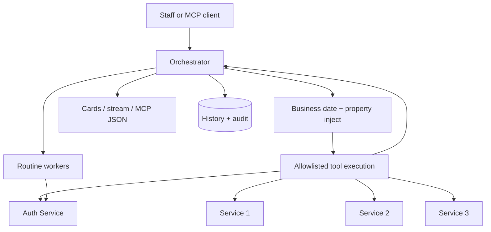

## Deep Dive: Agent Architecture & Tool Orchestration

**Project:** AI assistant and tool layer for a multi-service hotel property management system  
**Role:** Backend / platform engineering — orchestrator, tool registry, security gates, automation hooks  
**Stack:** Go, PostgreSQL, OpenAPI-derived tools, multi-provider LLM adapter, OAuth/MCP (read path), scheduled routines

In hotel operations, front-desk and night-audit staff need answers immediately—whether reconciling yesterday’s business day, verifying guest balances before checkout, or checking room and housekeeping status across buildings. A single “chat API” cannot answer those questions safely: data lives behind several REST services, permissions differ by role, and **“today”** on the wall clock is not **today** in the hotel’s books.

This project is an **agent orchestrator** that sits between staff (and, on a separate surface, external AI clients) and the PMS. It does not own reservations or ledgers. It **plans reads**, **executes only allowlisted GETs under the caller’s credentials**, **forces property scope in code**, and **turns JSON into structured answers**—with a fallback path when the model is unavailable.

---

### Multi-Service Topology

The property management backend is composed of discrete services:

| Service Domain            | Responsibility                                                    |
| ------------------------- | ----------------------------------------------------------------- |
| **Auth & Session**        | JWT validation, property membership, RBAC route matrix            |
| **Service 1 (Settings)**  | Room types, taxes, rate plans, property metadata (incl. timezone) |
| **Service 2 (Operations)**| Stays, folios, housekeeping, operational workflows                |
| **Service 3 (Analytics)** | Aggregated summaries, collections, export-oriented reads          |

```
[ Staff question in plain text (+ active property) ]
                        ↓
[ Agent Orchestrator (Go) — single binary ]
   ├── Session gate: token valid + user allowed on property
   ├── Business-date resolution (night-audit anchor, not server clock)
   ├── Intent / planner path OR keyword handler fallback
   ├── Tool allowlist (OpenAPI-generated reads, admin/export/internal stripped)
   ├── Property injection on every downstream call (model cannot widen scope)
   └── Parallel GET execution → user JWT forwarded as downstream identity header
                        ↓
[ Internal REST APIs — RBAC enforced per route ]
                        ↓
[ Presenter: short text + typed cards (table, chart, stats) ]
                        ↓
[ Verified answer + persisted turn & tool audit ]

Parallel tracks (same security philosophy, different front door):
   • Scheduled / conditional routines — grant + short-lived delegated token at run time
   • MCP read-only tool server — OAuth bearer, no in-house planner, same read filter
```

**Design choice:** Treat the LLM as a **planner and presenter**, not as the system of record. Numbers come from API responses; scope and dates are **server invariants**.

---

### Critical Problem: “Today,” Time Zones, and Missing Query Params

When queries used relative language—_“yesterday,” “last week,” “who arrives today”_—naive LLM-orchestrated API calls failed in predictable ways:

1. The model assumed **UTC or server local time**, not the property’s IANA zone and **night-audit working date**.
2. OpenAPI tools often require **paired date fields** or explicit filters; omitted params yielded empty reports or 400s the model could not recover from.
3. Letting the model freely set `propertyId` would violate **one-property-at-a-time** product rules.

**Resolution:** A three-layer contract—

| Layer              | Behavior                                                                                                                                                                                                   |
| ------------------ | ---------------------------------------------------------------------------------------------------------------------------------------------------------------------------------------------------------- |
| **Anchor context** | Resolve “today” from night-audit working date (cached briefly from property config), with property timezone for display and scheduling.                                                                    |
| **Dispatcher**     | Before any outbound GET: overwrite path/query `propertyId` (and property path segments) with the active property; fill required dates from business date or copy partner fields (`startDate` ↔ `endDate`). |
| **Planner policy** | Model chooses _which_ allowlisted tools to call; it does not own tenant scope or the authoritative calendar.                                                                                               |

Illustrative orchestration (portfolio pseudocode—not production):

```go
// internal/orchestrator/request_context.go
package orchestrator

import (
	"context"
	"time"
)

type ReadRequest struct {
	PropertyID    int
	UserToken     string
	BusinessDate  time.Time // night-audit "today"
	PropertyTZ    *time.Location
	PlannedReads  []PlannedToolCall
}

func (e *Engine) ExecuteReads(ctx context.Context, req ReadRequest) ([]ReadResult, error) {
	for i := range req.PlannedReads {
		call := &req.PlannedReads[i]
		if !e.allowlist.IsPermittedRead(call.ToolName) {
			return nil, ErrToolNotInPolicy
		}
		// Invariant: scope and dates are server-owned
		call.Args = e.forcePropertyScope(call.Args, req.PropertyID)
		call.Args = e.fillRequiredDates(call.Args, req.BusinessDate, req.PropertyTZ)
	}
	return e.runParallelGETs(ctx, req.UserToken, req.PlannedReads)
}
```

**Outcome:** Relative questions map to the same windows front-desk staff expect on reports, without trusting the model to guess ISO boundaries or property ids.

---

### Critical Problem: Security Without Prompt Religion

Interactive chat benefits from prompts (“refuse writes,” “mask card numbers,” narrow scope). **External MCP clients bring their own models and prompts**—so MCP and automation paths rely only on:

- OAuth consent with an explicit **property** on the grant
- Opaque access token → **token exchange** → ~120s delegated user JWT used **once** per downstream call
- Same read allowlist as chat; **no write tools** in v1 MCP
- Separate **audit** rows attributing user, client, grant, tool, and outcome

**Lesson for the portfolio:** Split **“AI product surface”** (planner, cards, confirmations) from **“AI tool surface”** (protocol + allowlist + injection). Shared filters; not shared trust in instructions.

---

### Tool Orchestration Model

Hundreds of generated tools are registered from sibling OpenAPI specs. At runtime:

```
Registry (all generated tools)
        ↓ filter at startup
Allowlisted GET reads only (~300+ tools, minus admin/internal/export)
        ↓ planner or MCP tools/list
Subset chosen per turn OR full list exposed to MCP client
        ↓ dispatcher
Forced propertyId + date/param completion → parallel execution
        ↓
Presenter (chat) OR passthrough JSON (MCP)
```

**Multi-step staff workflows** (check-in, assign room, collect payment) use an **agent loop**: reads until context is sufficient, then **in-chat confirmation flows** or schema-driven write forms—writes never bypass the user’s token and the PMS’s RBAC. **Background routines** reuse the same engine with a reviewed definition, grant-based tokens, and an allowlisted autonomous write path where product requires it.

---

### What I Learned

1. **Enterprise agents are state machines with guardrails.** The LLM proposes tool names and parameters; invariants (property, business date, allowlist, PCI patterns) belong in Go.
2. **OpenAPI as the tool contract** scales better than hand-written integrations—if paired with a strict filter and CI regen from service specs.
3. **One permission system.** The orchestrator does not maintain a shadow RBAC matrix; 403 from upstream becomes a denied or error card—simpler audits, sharper UX when roles are wrong.
4. **Two HTTP personalities in one process** (chat streaming vs MCP streams) avoid timeout and trust-boundary mistakes.
5. **Automation credentials are grants, not service accounts.** Background runs exchange revocable secrets for short-lived tokens with **live permission re-check**—same pattern as MCP, different UX.

---

### What’s Next (and what shipped adjacent to this work)

| Phase                 | Capability                                                                                                                                                  |
| --------------------- | ----------------------------------------------------------------------------------------------------------------------------------------------------------- |
| **Shipped / in tree** | Scheduled and conditional **routines** (Postgres queue, workers, inbox/chat/email delivery); **MCP** read-only tool server with OAuth                       |
| **Next**              | Webhook- and event-driven routine triggers with debounced condition evaluation; richer MCP capability kinds (guarded writes, notifications) with re-consent |
| **Product**           | Human approval for high-risk autonomous writes in automation; multi-replica session state for MCP property switching                                        |

---

### Architectural Highlights

- Built a **Go orchestrator** between a Next.js front-desk panel and four PMS microservices, with streaming SSE and card-based answers.
- Solved **business-date and timezone anchoring** so relative staff language maps to correct report windows.
- Designed **MCP + OAuth token exchange** so external AI tools inherit the same read allowlist and RBAC as the in-app chat agent—without forwarding long-lived browser JWTs.
- Introduced **routines** as validated JSON pipelines with grant-based background execution and audit parity with interactive chat.

---

### Architecture Flow (Mermaid)



---

### Related Architecture Deep Dives

- [Inside a Hotel PMS AI Orchestrator: Multi-Service LLMs, Automation, and Zero-Trust Access](/blog/hotel-pms-ai-orchestrator)
- [Building a Read-Only MCP Tool Server: Zero-Trust Hotel PMS Access for Claude, Cursor, and Beyond](/blog/hotel-pms-mcp-tool-server)
