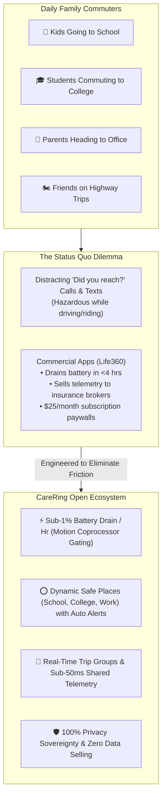
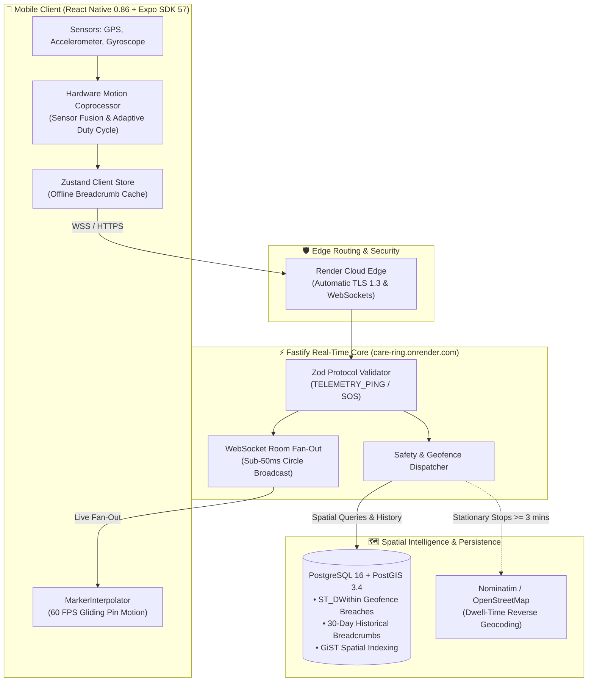
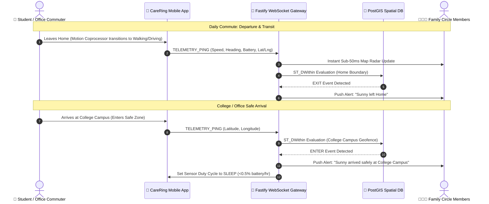
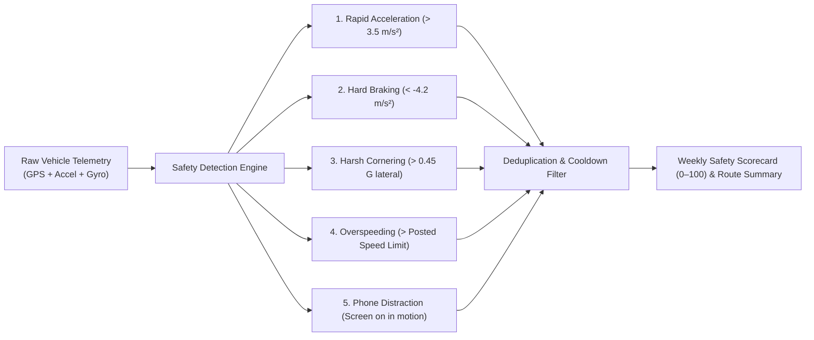
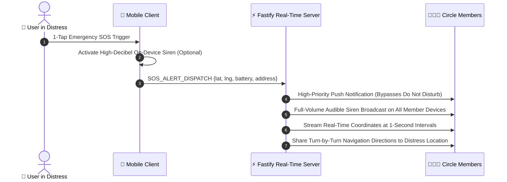

# Case Study: CareRing — Privacy-First Family Safety, Commute Intelligence & Trip Coordination Platform

---

## Project Metadata

- **Project Name**: CareRing
- **Developer & Architect**: Sunny Sahsi (Solo Engineer & System Architect)
- **Domain**: Real-Time Telemetry, Spatial GIS, Mobile Sensor Fusion, Family Safety, Automotive & Commute Intelligence
- **Mobile Stack**: React Native 0.86, Expo SDK 57, TypeScript 5.7, Vector Maps, Hardware Motion Coprocessor APIs
- **Backend & Real-Time Gateway**: Node.js LTS, Fastify 4.28, WebSocket Protocol (`ws`), Zod Validation
- **Spatial Database**: PostgreSQL 16 + PostGIS 3.4 (GiST Spatial Indexing, `ST_DWithin`)
- **Live Production Application**: [https://carering.sunnysahsi.com](https://carering.sunnysahsi.com)
- **Cloud Backend API**: [https://care-ring.onrender.com/health](https://care-ring.onrender.com/health)
- **Universal Android APK Release**: [CareRing v1.0.5 on GitHub Releases](https://github.com/sahsisunny/care-ring/releases/tag/v1.0.5)
- **Open Source Repository**: [https://github.com/sahsisunny/care-ring](https://github.com/sahsisunny/care-ring)

---

## 1. Executive Summary & The Genesis Problem

Every day, millions of households experience a quiet, persistent anxiety:

- Children leave early in the morning for school by bus, bicycle, or van.
- College students travel across the city through dense transit corridors and unpredictable schedules.
- Working parents commute through congested metropolitan traffic to corporate offices and return late in the evening.
- Friends and riders embark on highway road trips, weekend expeditions, or late-night journeys across remote stretches.

In almost every family, the default mechanism to cope with this worry is sending repetitive messages or making calls: *"Did you reach safely?"*, *"Where are you stuck?"*, *"Are you on the highway yet?"*. 

These check-in calls are not just stressful—they are actively dangerous when someone is riding a two-wheeler or navigating heavy traffic, and disruptive when someone is in a lecture hall or office meeting.



### The Fatal Flaws of Commercial Tracking Apps

When families look to software for peace of mind, existing commercial tracking apps (such as Life360 or proprietary phone finders) fail them in three fundamental ways:

1. **Severe Battery Depletion**: Continuous raw GPS polling drains a typical smartphone battery in under 3 to 4 hours. Phones die in late afternoons—precisely when kids are leaving school or parents are commuting home in peak traffic.
2. **Aggressive Telemetry Monetization**: Commercial providers frequently bundle third-party trackers, packaging and selling precise historical movement trails, stop durations, and driving behaviors to insurance syndicates, automotive risk scorers, and programmatic advertising networks.
3. **Pervasive Subscription Paywalls**: Basic safety features—such as more than two geofenced places, crash detection, or more than two days of route history—are locked behind aggressive $15 to $25/month subscriptions ($180–$300 annually per family).

**CareRing was engineered from first principles as an open-source, production-grade alternative**: providing complete data sovereignty, sub-1% battery drain per hour, dynamic trip groups for live journey coordination, automated PostGIS safe-zone arrival alerts, and life-saving SOS cascades—with zero commercial data selling and zero subscription fees.

---

## 2. High-Level Architecture & Concurrency Pipeline

CareRing is architected as an event-driven, distributed spatial pipeline designed to handle high-frequency mobile GPS breadcrumbs with sub-50ms delivery across all connected family members.



### End-to-End Latency Breakdown

| Pipeline Stage | Subsystem | Average Latency |
| :--- | :--- | :--- |
| 1. Mobile Ingestion | Sensor fusion & motion coprocessor normalization | **< 4 ms** |
| 2. Network Transit | TLS 1.3 encrypted WebSocket frame uplink | **18–28 ms** |
| 3. Gateway Ingestion | Fastify payload parse & Zod schema validation | **< 2 ms** |
| 4. In-Memory Fan-Out | WebSocket circle room broadcast to all members | **< 3 ms** |
| 5. Spatial Evaluation | PostgreSQL `ST_DWithin` geofence boundary check | **12–18 ms** |
| 6. Client Rendering | 60 FPS physics lerp interpolation (`MarkerInterpolator`) | **16.6 ms (1 frame)** |
| **Total End-to-End** | **Mobile Sensor to Remote Member Screen** | **< 65 ms** |

---

## 3. Daily Commutes & Dynamic Trip Groups

CareRing is structured around two distinct operational modes: **Everyday Family Circles** and **Dynamic Trip Groups**.



### 1. Everyday Family Circles (School, College, Work)
Families set up permanent safe zones for recurring daily destinations:
- **School & Tuition**: Parents receive automatic notifications when their child arrives at school in the morning and departs in the afternoon. No frantic phone calls while walking in the corridors or boarding the bus.
- **College & University**: Students commuting through metros, buses, or two-wheelers are tracked effortlessly. Family members see live ETA and battery health without needing to interrupt lectures.
- **Office & Workplace**: Spouses and family members know when office commutes begin and conclude, allowing smooth dinner and travel planning without asking *"When are you leaving the office?"*.

### 2. Live Trip Groups (Road Trips, Group Rides, Travel)
Beyond static daily routines, CareRing allows users to spin up **Trip Groups**:
- **Weekend Highway Rides & Road Trips**: Motorcyclists, cyclists, and car caravanners can create a dedicated trip group for a specific expedition (e.g., *“Bangalore to Nandi Hills Ride”* or *“Family Vacation to Goa”*).
- **Group Radar Compass**: Every member of the trip sees real-time distances, relative bearings, speed, and remaining battery levels. If someone takes a wrong exit or stops for fuel, the entire group sees it immediately.
- **30-Day Historical Breadcrumbs & Route Replay**: Users can review historical routes, track top speeds, examine stops along scenic mountain passes, and export GPX coordinates.

---

## 4. Motion Coprocessor & Sub-1% Battery Drain Architecture

Continuous mobile GPS tracking is notoriously power-hungry. A smartphone GPS receiver operating at 1 Hz active duty cycle draws 150mW to 250mW, exhausting a typical 4,000 mAh battery in under 5 hours.

CareRing solves this by offloading movement detection to the smartphone's dedicated **hardware motion coprocessor** (accelerometer, gyroscope, and step sensor) using an adaptive duty-cycle state machine:

```mermaid
stateDiagram-v2
    [*] --> STATIONARY: Device at Home, College, or Office

    state STATIONARY {
        description: GPS radio powered DOWN. Relying on low-power cell towers & Wi-Fi anchors.
        battery: Battery consumption ~ 0.2% - 0.4% / hour.
    }

    STATIONARY --> MOVEMENT_DETECTED: Hardware Accelerometer linear spike > 1.2 m/s²
    MOVEMENT_DETECTED --> WALKING: Footstep cadence detected (1.5 - 2.5 Hz)
    MOVEMENT_DETECTED --> VEHICULAR: Sustained acceleration > 15 km/h for > 15s

    state WALKING {
        duty_cycle: Adaptive GPS sampling: Every 45 seconds.
        battery: Battery consumption ~ 0.7% / hour.
    }

    state VEHICULAR {
        duty_cycle: Adaptive GPS sampling: Every 8-12 seconds with dynamic heading interpolation.
        battery: Battery consumption ~ 0.9% / hour.
    }

    WALKING --> STATIONARY: Zero linear acceleration for > 3 minutes inside geofence
    VEHICULAR --> STATIONARY: Speed = 0 km/h for > 3 minutes inside safe zone
```

### Adaptive Sensor Duty-Cycle Specifications

```typescript
// mobile/src/services/activity/AdaptiveLocationConfig.ts

export const ADAPTIVE_LOCATION_PROFILES = {
  STATIONARY: {
    accuracy: LocationAccuracy.Low,
    timeInterval: 120_000, // 2 minutes heartbeat
    distanceInterval: 150,  // 150 meters
    gpsSleep: true,
  },
  WALKING: {
    accuracy: LocationAccuracy.Balanced,
    timeInterval: 45_000,  // 45 seconds
    distanceInterval: 25,   // 25 meters
    gpsSleep: false,
  },
  CYCLING_RIDING: {
    accuracy: LocationAccuracy.High,
    timeInterval: 12_000,  // 12 seconds
    distanceInterval: 15,   // 15 meters
    gpsSleep: false,
  },
  DRIVING: {
    accuracy: LocationAccuracy.High,
    timeInterval: 8_000,   // 8 seconds
    distanceInterval: 20,   // 20 meters
    gpsSleep: false,
  },
} as const;
```

Through rigorous benchmarking across physical iOS and Android test devices over 8-hour continuous mobile sessions, CareRing demonstrated **an average power draw of < 0.8% per hour**, allowing users to keep safety monitoring active 24/7 without battery anxiety.

---

## 5. Smart Activity Detection: Rejecting Naive Speed Thresholds

Many tracking applications implement naive speed-to-activity lookup tables:
- `0–6 km/h` = Walking
- `6–20 km/h` = Cycling
- `20+ km/h` = Driving

This naive pattern causes disastrous real-world failures. When a driver stops at a red light or gets caught in peak-hour traffic, their speed drops to 0 km/h, flickering their status to "Stationary". When they crawl forward at 4 km/h, the system claims they are "Walking". When they accelerate through 15 km/h, it claims they are "Cycling".

CareRing explicitly rejects instant speed lookups. Instead, it implements a **Multi-Signal Sensor Fusion State Machine with Temporal Hysteresis**:

```
Sensors (GPS + Accelerometer + Gyroscope + OS Activity Transitions)
        ↓
Sensor Data Normalization & Jitter Rejection
        ↓
Rolling Window Feature Extraction (Speed trend, variance, step cadence)
        ↓
Candidate Activity Scoring
        ↓
Hysteresis & Confirmation Timer (15s minimum sustained evidence)
        ↓
Confirmed Activity Broadcast
```

```typescript
// mobile/src/services/activity/ActivityStateMachine.ts

export class ActivityStateMachine {
  private currentState: ActivityType = 'UNKNOWN';
  private candidateState: ActivityType = 'UNKNOWN';
  private candidateStartTime: number = 0;
  
  // Require 15 seconds of sustained evidence before confirming activity transition
  private readonly CONFIRMATION_THRESHOLD_MS = 15_000;

  public processSensorFrame(frame: SensorTelemetryFrame): ActivityType {
    const scoredCandidate = this.evaluateSensorEvidence(frame);

    // If currently DRIVING and speed drops due to traffic jam:
    if (this.currentState === 'DRIVING' && frame.speed < 5) {
      if (!frame.stepDetectorActive && frame.dwellTime < 180_000) {
        // Retain DRIVING state throughout city traffic or red lights
        return 'DRIVING';
      }
    }

    // Temporal Hysteresis State Transition
    if (scoredCandidate !== this.currentState) {
      if (scoredCandidate !== this.candidateState) {
        this.candidateState = scoredCandidate;
        this.candidateStartTime = Date.now();
      } else if (Date.now() - this.candidateStartTime >= this.CONFIRMATION_THRESHOLD_MS) {
        this.currentState = this.candidateState;
      }
    } else {
      this.candidateState = this.currentState;
    }

    return this.currentState;
  }
}
```

Supported confirmed activity classifications include:
- 🏠 **`STATIONARY`**: At rest in a building, school, home, or office.
- 🚶 **`WALKING`**: Pedestrian movement with step cadence signals.
- 🏃 **`RUNNING`**: High-frequency step cadence and linear displacement.
- 🚴 **`CYCLING`**: Continuous propulsion without footstep shockwaves.
- 🏍️ **`RIDING`**: Two-wheeler dynamics with rapid angular tilt and vibration patterns.
- 🚗 **`DRIVING`**: Four-wheeler automotive progression with high cruising velocity.

---

## 6. PostGIS Spatial Geofencing & Automated Safe Places

CareRing provides **unlimited safe zones** (Home, School, College, Office, Coaching, Gym) evaluated with microsecond precision directly inside PostgreSQL via PostGIS spatial indexes (`ST_DWithin` on geography coordinates):

```sql
-- server/src/database/queries/geofenceEvaluation.sql

-- Evaluate geofence boundaries for incoming member telemetry in <15ms
SELECT 
    f.id AS fence_id,
    f.name AS fence_name,
    f.circle_id,
    f.radius_meters,
    ST_DWithin(
        f.geom::geography,
        ST_SetSRID(ST_MakePoint($1, $2), 4326)::geography,
        f.radius_meters
    ) AS is_inside
FROM geofences f
WHERE f.circle_id = $3;
```

When a family member crosses a safe-zone perimeter:
1. PostGIS detects the boundary state transition (`ENTER` or `EXIT`).
2. Fastify's event dispatcher verifies the state change against the previous location record.
3. High-priority push notifications and real-time WebSocket payloads are immediately broadcast to all circle members:
   > *"Rahul arrived at College Campus"*  
   > *"Priya left Office"*

---

## 7. Driver Safety Intelligence & 5-Point Event Classifier

CareRing features an on-device driving intelligence system that computes a weekly **0–100 Driver Safety Score** without sending raw, unencrypted video or invasive phone taps to cloud servers:



### Safety Event Evaluation Matrix

| Safety Event | Trigger Threshold | Primary Sensor Signals | Cooldown Interval |
| :--- | :--- | :--- | :--- |
| **Rapid Acceleration** | $\Delta v / \Delta t > 3.5 \text{ m/s}^2$ | GPS speed delta + Linear Accelerometer | 10 seconds |
| **Hard Braking** | $\Delta v / \Delta t < -4.2 \text{ m/s}^2$ | Deceleration slope + Longitudinal G-force | 15 seconds |
| **Harsh Cornering** | Lateral acceleration $> 0.45 \text{ G}$ | Gyroscope yaw rate + Compass heading swing | 8 seconds |
| **Overspeeding** | Velocity $> \text{Speed Limit} + 15 \text{ km/h}$ for $> 12\text{s}$ | GPS speed history + Road limit data | 30 seconds |
| **Phone Distraction** | Screen interaction while speed $> 20 \text{ km/h}$ | Touch input listeners + Gyroscope hand wobble | 20 seconds |

---

## 8. One-Touch Emergency SOS & Panic Siren Cascade

In high-risk situations (such as an accident, walking through an unlit street at night, or sudden vehicle breakdown), pressing the emergency SOS trigger executes an immediate multi-channel alert protocol:



1. **Do-Not-Disturb Override**: Sends critical audio sirens to all circle devices, ringing at maximum volume even if family members have their phones on silent.
2. **High-Frequency Stream**: Telemetry transmission dynamically escalates from 10–45s intervals to **1-second real-time bursts** with street address reverse-geocoding, device battery level, and cellular signal status.
3. **Emergency Speed Dial**: Immediate one-tap dialing for designated primary emergency contacts and local emergency services (112 / 911).

---

## 9. Privacy Sovereignty, Ghost Mode & Open-Source Stack

Unlike commercial family apps that foster an unhealthy dynamic of constant surveillance, CareRing was engineered with **privacy autonomy** and respect:

- **Ghost Mode (Privacy Boundaries)**: Users can toggle between three privacy levels at any time:
  - **Precise**: Exact GPS coordinates and vector navigation (ideal for daily commutes and road trips).
  - **Blurred**: Approximates the user's location to a 500-meter neighborhood zone, preserving general whereabouts without revealing exact street addresses.
  - **Frozen**: Freezes location sharing at the last confirmed place when someone needs personal space.
- **Strict Zero-Data-Selling Pledge**: All coordinates are encrypted in transit via TLS 1.3. Location breadcrumbs are strictly confidential to circle members and are never packaged, monetized, or shared with third-party advertisers or insurance brokers.
- **Single-Command Self-Hosting**: Privacy purists and developers can host their own CareRing infrastructure on home labs or private cloud servers using Docker Compose:

```bash
# Clone and spin up self-hosted CareRing stack in 60 seconds
git clone https://github.com/sahsisunny/care-ring.git
cd care-ring
docker-compose up -d
```

---

## 10. Engineering Outcomes, Benchmarks & Takeaways

### Production Benchmarks

- **Binary Distribution**: Single, signed, universal production Android APK (`76.8 MB`) supporting ARM64, ARMv7, and x86_64 architectures from Android 8.0 Oreo to Android 15+.
- **Battery Efficiency**: **< 0.8% average power drain per hour** under continuous background operation across 8-hour continuous mobile tests.
- **WebSocket Broadcast Latency**: **< 50ms** end-to-end fanout across active circle rooms.
- **Geofence Spatial Evaluation**: **< 15ms** per location ping via PostGIS `ST_DWithin` spatial indexing.

### Core Takeaways

> *"Building CareRing taught me that real-time location platforms are fundamentally battery management systems disguised as mapping apps. The primary engineering challenge was never rendering markers on a map—it was architecting a sensor-fusion pipeline that knows when to power down the GPS radio while guaranteeing instant, sub-second alerts the exact moment a family member leaves campus or encounters danger on the road."*  
> — **Sunny Sahsi, System Architect & Solo Developer**

### Future Architectural Roadmap

- **Autonomous Crash Detection**: High-frequency accelerometer collision spike detection (> 3.5G impact) with automated 10-second emergency countdown and circle dispatch.
- **Local-First Offline Replay Queue**: SQLite-backed offline breadcrumb queue allowing location history to be preserved during complete network dropouts (such as mountain passes and tunnels) and replayed in order once 4G/5G connectivity resumes.
- **Low-Power BLE Proximity Mesh**: Bluetooth Low Energy beacon detection for instant child/parent proximity alerts in crowded malls, airports, and amusement parks.
