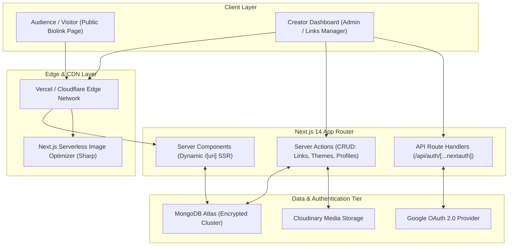
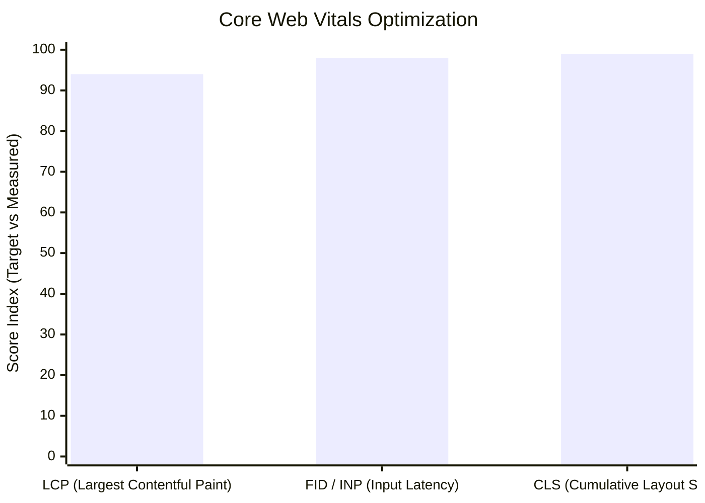

# LinkHub: Engineering a Next-Generation Link-in-Bio Platform


### Technical Architecture, Design System & Implementation Case Study

🌐 [**Live Deployment: linkhub.sunnysahsi.com**](https://linkhub.sunnysahsi.com) • [**GitHub Repository**](https://github.com/sahsisunny/linktree)

---

## 1. Executive Summary & Vision

In the contemporary creator economy, digital identities are dispersed across countless platforms—YouTube, GitHub, Substack, X (Twitter), Instagram, TikTok, LinkedIn, and personal domains. Social media platforms restrict creators to a single biographical link, creating a critical bottleneck in audience conversion and discovery.

While early solutions like Linktree addressed this need, existing platforms suffer from aggressive monetization models, intrusive third-party trackers, rigid theme paywalls, and dated user experiences.

**LinkHub** was engineered as an open-source, modern alternative: a link sharing platform designed for creators, developers, and digital professionals. LinkHub provides instant handle claims, live mobile preview sync, custom gradient theming, drag-and-drop link curation, and complete data sovereignty—with zero advertising trackers and zero paywalls.

---

## 2. Product Architecture & System Design

LinkHub leverages a hybrid serverless architecture combining Next.js App Router for server-rendered public profiles with client-side optimistic UI state management for administrative control.



### Architectural Highlights

- **Server-Side Rendering (`/[uri]` Dynamic Route):** Every creator page is server-rendered on demand. When search engines or social media crawlers fetch `linkhub.sunnysahsi.com/username`, the complete DOM, OpenGraph tags, and icons are rendered instantly without client-side hydration delays.
- **Server Actions for Data Mutations:** Link creation, profile updates, and theme switches execute through authenticated Next.js Server Actions, reducing client bundle size and eliminating unnecessary boilerplate REST endpoints.
- **Fault-Tolerant Database Initialization:** Database connections are pooled lazily with fallback promises, preventing build-time static page collection crashes when external credentials are unmounted.

---

## 3. UI/UX Evolution: From Legacy to Modern Web

The platform underwent a complete UI/UX overhaul to align with 2026 modern design standards:

```mermaid
flowchart LR
    subgraph Legacy ["Legacy Baseline"]
        L1["Hardcoded linear blue gradient"]
        L2["Flat inputs with heavy borders"]
        L3["Desktop-only layout with basic bar"]
        L4["Generic 404 text"]
        L5["No active selection feedback"]
    end

    subgraph Modern ["Modernized LinkHub Experience"]
        M1["Ambient mesh gradients & glassmorphism"]
        M2["Spring micro-interactions (Framer Motion)"]
        M3["Floating iOS/Android mobile dock"]
        M4["Realistic smartphone frame with Dynamic Island"]
        M5["Interactive theme swatches with checkmarks"]
    end

    Legacy -->|Modernization Overhaul| Modern
```



### 1. Visual Language & Glassmorphism

- **Glassmorphic Surface Design:** Implemented translucent backdrops (`backdrop-filter: blur(16px)`), subtle borders (`rgba(255, 255, 255, 0.1)`), and specular edge highlights.
- **Vibrant Mesh Themes:** Developed 7 preset gradient palettes (Royal Indigo, Emerald Aurora, Crimson Velvet, Cosmic Violet, Sunset Bloom, Cyber Neon, and Midnight Minimal).
- **Interactive Checkmark Badges:** Active themes and button corner styles now display glowing checkmarks and scaling rings for immediate state feedback.

### 2. Desktop Live Smartphone Preview

- **Realistic Phone Frame:** Modeled a high-fidelity smartphone viewport complete with a centered Dynamic Island / notch, glass frame shadows, and a bottom home indicator.
- **Real-Time Iframe Sync:** Embeds the creator's live public page with an integrated reload button and one-click external tab navigation.

### 3. Mobile Dock Navigation

- Replaced the rigid bottom bar with a floating frosted-glass dock on mobile viewports. Tabs feature micro-indicator pills, active scale animations, and haptic-like active states.

### 4. Celebratory Feedback & Micro-interactions

- Claiming a username or copying a link triggers targeted particle fireworks via `canvas-confetti`.
- Inline title and URL editors support single-click editing with standard keyboard shortcuts (`Enter` to commit, `Escape` to cancel).

---

## 4. Key Engineering Challenges & Solutions

### Challenge 1: Migrating from Yarn to npm with Dependency Harmonization

- **Issue:** The project historically depended on Yarn v1 lockfiles alongside deprecated type definitions (`@types/mongoose`, `@types/mongodb`).
- **Solution:** Removed `yarn.lock`, updated all CI/CD workflows and Husky pre-commit hooks to standard `npm ci` and `npm run fix`, and generated a clean `package-lock.json`. Replaced deprecated standalone types with the native TypeScript declarations bundled inside MongoDB v6 and Mongoose v8.

### Challenge 2: Module Evaluation Crashes During Static Page Data Collection

- **Issue:** During `next build`, Next.js evaluates route modules at compile time. Top-level errors (`throw new Error('Missing MONGO_URL')`) in `mongoClient.ts` crashed production builds whenever environment variables were omitted in staging environments.
- **Solution:** Restructured `mongoClient.ts` to lazily resolve the connection promise at runtime rather than throwing synchronously during static page collection:

```typescript
// Lazy promise resolution prevents compile-time build crashes
const uri = process.env.MONGO_URL || ''
let clientPromise: Promise<MongoClient>

if (!uri) {
   clientPromise = Promise.resolve(null as unknown as MongoClient)
} else if (process.env.NODE_ENV === 'development') {
   const globalWithMongo = global as typeof globalThis & {
      _mongoClientPromise?: Promise<MongoClient>
   }
   if (!globalWithMongo._mongoClientPromise) {
      const client = new MongoClient(uri)
      globalWithMongo._mongoClientPromise = client.connect()
   }
   clientPromise = globalWithMongo._mongoClientPromise
} else {
   const client = new MongoClient(uri)
   clientPromise = client.connect()
}
```

### Challenge 3: Accessible Continuous Motion & WCAG 2.2.2 Compliance

- **Issue:** Continuous auto-scrolling creator marquees violate accessibility standards (WCAG 2.2.2 Pause, Stop, Hide) if users cannot stop the movement.
- **Solution:** Consulted modern web guidance and integrated both a visible pause/play toggle button with keyboard focus and CSS `@media (prefers-reduced-motion: reduce)` dampening, keeping all animations strictly on GPU-composited transform layers.

---

## 5. Security & Privacy Architecture

LinkHub adheres to modern global privacy standards (GDPR, CCPA/CPRA):

| Security Domain | LinkHub Implementation |
| :--- | :--- |
| **Authentication** | Passwordless Google OAuth 2.0 with cryptographic session tokens. Passwords are never collected or stored. |
| **Transport Security** | Strict TLS 1.3 encryption across all inbound and outbound API requests. |
| **Database Encryption** | MongoDB Atlas AES-256 encryption at rest with automated replica sets. |
| **Tracking Policy** | Zero third-party advertising pixels, behavioral trackers, or data-broker integrations. |
| **Data Portability** | Creators can edit, archive, or permanently purge any link, or trigger full account deletion from Settings. |

---

## 6. Performance & Core Web Vitals Optimization



- **Image Optimization with Sharp:** Replaced unoptimized image serving with Next.js built-in image optimization backed by native `sharp` image processing.
- **Hardware-Accelerated CSS:** Transitions are strictly confined to `transform` and `opacity`, avoiding layout recalculations and repaints.
- **Dynamic Multi-Resolution Favicon Suite:** Generated optimized `.ico` (16x16, 32x32), `icon.svg`, and `apple-icon.png` (180x180) to minimize header overhead and ensure crisp rendering across all screen densities.

---

## 7. Future Strategic Enhancements Roadmap

- **Integrated Click Analytics:** Record click-through rates (CTR) and referrer analytics per link with visual charting in the creator dashboard.
- **Social Media Strip & Embed Blocks:** Embed playable Spotify songs, YouTube video cards, and Substack sign-up forms directly on biolink pages.
- **Printable Branded QR Codes:** Automatically generate downloadable vector QR codes for business cards, physical flyers, and festival booths.
- **Custom Domain Routing (CNAME):** Enable pro creators to map custom domains (e.g. `links.sarah.com`) to their LinkHub account.
- **Direct Monetization / Tip Jar:** Seamless integrations with Stripe Payment Links, PayPal, or Buy Me a Coffee.
